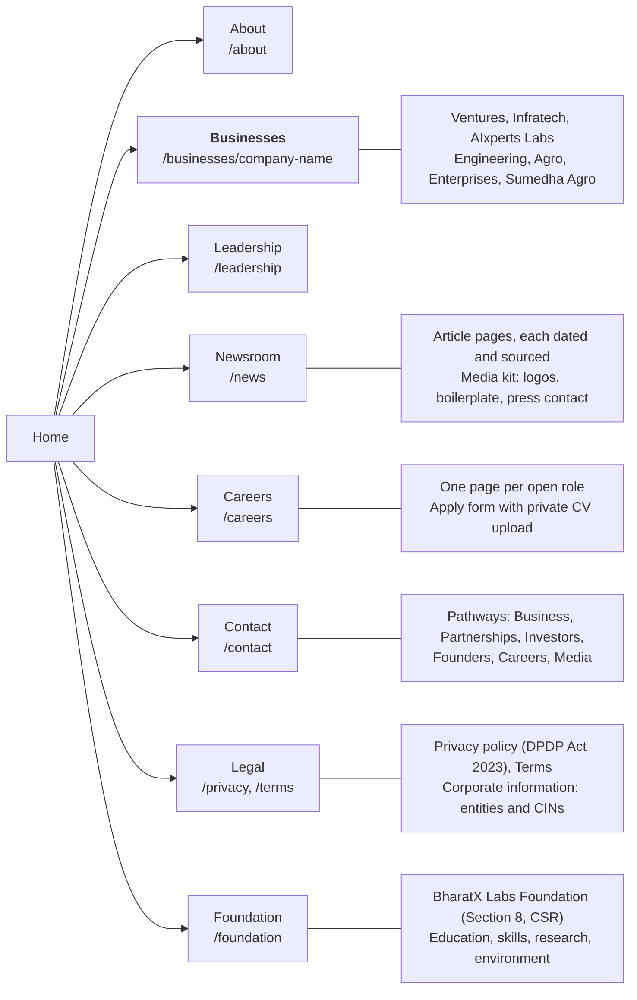
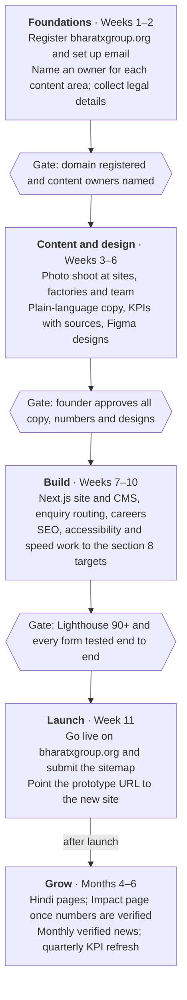

# BharatX Group Website — PRD

23 Oct 2026 · Live doc: https://claude.ai/artifact/XzipgSDgtUt59dYjEseFS5

## 1. Overview

Build a new corporate website for BharatX Group at **bharatxgroup.org**, from scratch, that earns trust through facts rather than claims. This PRD assumes no existing site; the current prototype at bharatx.kynyx.com is a reference for what to keep (visual quality) and what to avoid (unverifiable claims, jargon).

**Why a new site.** A review of the prototype against Tata, Reliance, Adani, Mahindra, Aditya Birla, JSW and The Boston Group found that its design matches large groups, but its content does not hold up. It uses "sovereign" about 90 times and shows news and listed-company language (AGM, Chairman's Statement) that a visitor cannot verify. No benchmark site does this, and each one backs its claims with checkable facts.

**Goals**

1. A visitor understands in 5 seconds what BharatX Group is and which businesses it runs.
2. Every business has a clear profile and a route to its own website or sales contact.
3. Every claim on the site (number, client, milestone, news item) can be verified.
4. Enquiries from clients, partners, investors and job seekers reach the right inbox, every time.
5. The site loads fast on Indian mobile networks and ranks for the group and company names.

**Non-goals for launch**

- An investor-relations section with filings (the group is not listed).
- E-commerce or online ordering for any business.
- Replacing each company's own website; the group site links to them.

## 2. The group and its companies

The group runs seven businesses and a CSR foundation; BharatX confirmed all of them on 24 Oct 2026. Ventures and Infratech also show a CIN on their own sites. Checked on 23 Oct 2026 from each company's live website.

**Leadership team.** BharatX supplied these bios on 24 Oct 2026. They are the source copy for the Leadership page and the home-page founder section.

| Name | Role | Background | LinkedIn | Photo |
| --- | --- | --- | --- | --- |
| Pradeep Kumar | Group Chairman & Managing Director | 15+ years in product management, data, AI and enterprise technology. Master's in AI, IIT Delhi; MBA, IIM Ahmedabad. SAP Labs, Meta, Airtel, Samsung. Also Co-founder & MD of Casters Global. | [Profile](https://www.linkedin.com/in/pradeep-kumar-5170655b) | In repo: leadership/pradeep-kumar, from castersglobal.com (853 px) |
| Dharampal Singh | Chief Revenue & Operating Officer | 28+ years in automotive manufacturing and multi-site operations; teams of 1,000+. Plant Head at Jay Ushin Ltd (JPM Group), 1999–2026, three plants. Lean, Six Sigma, IATF 16949. Listed as Founder & CEO on [Casters Global](https://castersglobal.com/about) (to confirm). | [Profile](https://www.linkedin.com/in/dharampal-singh-995aa2228) | In repo: leadership/dharampal-singh, from castersglobal.com (800 px) |
| Nitin Arora | Executive Vice President — Product, Technology & AI | 15+ years in technology, product, AI and entrepreneurship. B.Tech CS, IIT Delhi; master's, NYU; PhD in CS, IIT Delhi. Google, Amazon, GE, iLabs, Deloitte; founded a startup. | [Profile](https://www.linkedin.com/in/aronitin) | In repo: leadership/nitin-arora (800×800) |
| Dr. Akanksha Verma | Chief Operating Officer | Environmental sciences and management: undergraduate, postgraduate, M.Phil. and Ph.D. Research in sustainability and pollution. | [Profile](https://www.linkedin.com/in/akanksha-verma-304a18191) | In repo: leadership/akanksha-verma-office (passport photo, office background added); a studio headshot is preferred |

**Website copy (as supplied)**

- **Pradeep Kumar** — Group Chairman & Managing Director. Pradeep Kumar is a technology and business leader with over 15 years of experience across product management, data, AI and enterprise technology. He holds a Master's in AI from IIT Delhi and an MBA from IIM Ahmedabad. Having worked with organisations including SAP Labs, Meta, Airtel & Samsung, he brings experience in technology-led product development and business strategy. At BharatX Group, he leads the Group's strategic direction, focusing on building sustainable businesses, advancing innovation and creating long-term value.
- **Nitin Arora** — Executive Vice President, Product, Technology & AI. Nitin Arora brings over 15 years of experience across technology, product innovation, artificial intelligence and entrepreneurship. He holds a bachelor's degree in Computer Science from IIT Delhi, a master's degree from New York University, and a PhD in Computer Science and Computation from IIT Delhi. His professional experience spans leading organisations including Google, Amazon, GE, iLabs and Deloitte, alongside building his own startup. At BharatX Group, he will lead product, technology and AI strategy, driving scalable innovation and the development of impactful, AI-powered solutions across the Group's portfolio.
- **Dr. Akanksha Verma** — Chief Operating Officer. Dr. Akanksha Verma has an academic background in environmental sciences and management, with qualifications spanning undergraduate and postgraduate studies, an M.Phil. and a Ph.D. Her expertise in environmental research, sustainability and pollution-related studies provides a foundation for her role as Chief Operating Officer at BharatX Group, where she will focus on operational coordination, execution and supporting the Group's strategic priorities.

Dharampal Singh: title and bio from BharatX (24 Oct 2026); spelling as on his LinkedIn (castersglobal.com spells it "Dharmapal"); photo from castersglobal.com. Copy notes: change "will lead" and "will focus" to "leads" and "focuses" once both have joined. Photos: professional headshots, at least 800 × 800 px, with matching background and lighting for all three.

**Group contact used today:** +91 98112 63046, Motilal Nehru Complex, New Delhi 110017.

| Company | What it does | Legal entity and base | Facts on its own site | Group link |
| --- | --- | --- | --- | --- |
| [AIxperts Labs](https://aixpertslabs.com/) | Enterprise AI and automation, AI training, HelloGini voice AI | AIxperts Labs Pvt Ltd, incorporated 2026 (per BharatX); CIN and address still needed | Claims "50K+ students", "200+ projects"; no mention of BharatX. Per BharatX: AI programme under the Ministry of MSME; MoUs with IIT Delhi, NSIC, ONGC and IGL; collaboration with CEHRO India | Confirmed |
| [BharatX Ventures](https://bharatx.vc/) | Venture building, SME growth capital, strategy consulting | Bharatx Ventures Pvt Ltd, CIN U01139BR2026PTC083018, Gaya, Bihar | Pradeep Kumar named Founder & CEO; claims "100Cr+ enterprise value", "50+ ventures supported" | Confirmed |
| [BharatX Infratech](https://bharatxinfratech.com/) | Roads, bridges, civil and power infrastructure | BharatX Infratech Pvt Ltd, CIN U41001BR2026PTC082273, Logix Cyberpark, Sector 62, Noida | Same phone as the group; claims "₹500Cr+ ongoing projects", "250+ heavy equipment", "15+ years" | Confirmed |
| [BharatX Engineering (Casters Global)](https://castersglobal.com/) | Industrial, medical and retail castors | Casters Global, Sector 10A, Gurgaon; since 2018 | ISO 9001:2015 and 14001:2015, "2.5L+ units shipped", 500+ variants; 50,000 sq ft Haryana facility (2025). Leadership: Dharmapal Singh (Founder & CEO), Pradeep Kumar (Co-founder & MD) | Confirmed |
| [BharatX Agro](https://bharatxagro.com/) | Agri-ingredient exports: makhana, moringa, onion powder, mushroom | Legal name not shown; "Export Tower, New Delhi"; "since 2020" | Claims APEDA, FSSAI, ISO 22000; "15+ countries", "500+ shipments" | Confirmed |
| BharatX Enterprises | Corrugated boxes and industrial packaging | No website found | None | Confirmed |
| [Sumedha Agro](https://sumedhaagro.com/) | Mushroom spawn production and farmer training | "SAMSPL", Banthra, Lucknow | Paid training batches Oct–Dec 2026; logo used in the prototype; no mention of BharatX | Confirmed |

**CSR arm:** BharatX Labs Foundation, a not-for-profit Section 8 company that runs the group's CSR activity. BharatX confirmed it on 24 Oct 2026. It brings together what earlier material showed as three separate units: BharatX Labs, BharatX Foundation and BharatX Sustainability. Its programmes cover education and skills, research, and the environment (waste and recycling). Its CIN, registered office and current programmes are still needed.

**BharatX Labs** (added 25 Oct 2026) is the Group's technology and R&D business, separate from BharatX Labs Foundation (the Section 8 CSR company). Its legal entity and details are still needed. **Sumedha Agro** was taken off the website on 25 Oct 2026 at BharatX's request.

**No planned units on the site.** The site shows what the group has and what it is building now. Drop BharatX CleanTech, which appears only on one prototype slide.

**Fix on company sites before launch.** The group site links to these sites, so visitors will judge the group by them.

- BharatX Agro shows +91 9876543210, a placeholder number, and stats that read "0+".
- AIxperts Labs shows Google, Microsoft and Apple logos under "Our students work at", with no backing.
- BharatX Infratech claims "15+ years", but its CIN shows 2026 incorporation.
- Casters Global calls itself "Comfort Castors" and "Castor Global" in places, and claims both "5+ years" and "over two decades" of experience.
- Casters Global spells his name "Dharmapal Singh"; his LinkedIn and BharatX's bio say "Dharampal".
- Bharatx Ventures shows two different emails (info@bharatx.vc and info@bharatx.ventures).
- AIxperts Labs and Sumedha Agro don't mention BharatX Group. Add a "Part of BharatX Group" line with a link to the group site, so each site confirms the other.

## 3. Audiences and key journeys

The site serves six audiences. Each one must reach its goal in three clicks or fewer from the home page.

| Audience | What they want to know | Journey on the site | Success |
| --- | --- | --- | --- |
| B2B buyer (castors, packaging, agri ingredients, infra work) | Can this business supply me, and how do I get a quote? | Home → Businesses → company page → "Get a quote" or the company's own site | Quote request reaches that company's sales inbox |
| Partner or government department | Is this group real, capable and compliant? | Home → About → Leadership → Contact (Partnerships) | Partnership enquiry with organisation details |
| Investor | What does the group own, who runs it, what is the plan? | Home → About → Businesses → Contact (Investors) | Investor enquiry routed to the founder's office |
| Founder or SME owner | Will BharatX Ventures help build or fund my business? | Home → BharatX Ventures → Contact (Founders) | Founder enquiry with a pitch summary |
| Job seeker | Which roles are open, and is this a good place to work? | Home → Careers → role → apply | Application stored and acknowledged by email |
| Media and general public | Basic facts, news, logos, contact person | Home → Newsroom → media kit | Press contact found in one click |

## 4. Brand, tone and messaging

Speak plainly and back every claim. The largest Indian groups use 3–4 word headlines (Reliance "Growth is Life", JSW "Living Better, Doing Better", Tata "Leadership with Trust") and none of them uses "sovereign" on its home page.

**Core messages**

- Tagline: **Building Businesses. Enabling Bharat.** (keep from the prototype)
- One-line description, shown under the hero: *BharatX Group is a technology-led Indian group building the businesses everyday India runs on — in AI and technology, infrastructure, manufacturing, agri-exports, packaging and venture building.*
- Founder line: Founded by Pradeep Kumar (IIT Delhi, IIM Ahmedabad) to build businesses that India's growth depends on.
- Positioning: a technology-led Indian group building the businesses everyday India runs on (decided 24 Oct 2026). Technology, engineering and AI are how BharatX builds; the core-sector businesses are what it builds; BharatX Labs Foundation is how it gives back. Say "growing group", not "conglomerate".

**Positioning: three pillars** (decided 24 Oct 2026). Technology is presented as how the Group builds, not as what every business is: six of the seven businesses operate in core sectors.

| Pillar | What it covers | Proof today |
| --- | --- | --- |
| Technology, engineering & AI (shown first) | AIxperts Labs; the Group's product, technology and AI team led by Nitin Arora; engineering in manufacturing and infrastructure | Leadership profiles; AIxperts Labs and its HelloGini product; the programme, MoUs and collaboration below |
| Core-sector businesses | Infrastructure, manufacturing, agri-exports, packaging, venture building | Seven businesses; CINs; Casters Global's Haryana factory |
| BharatX Labs Foundation (CSR) | Education and skills, research, environment and waste, health | CIN U85500UP2026NPL252546; programmes still needed |

Guardrails for the technology message:

- Say "technology-led" and "engineering and AI". Use "deeptech" only once there is original R&D to point to (a product, patent or research team).
- Show technology through real examples per business (what, where, since when), supplied by BharatX. No generic claims.
- The name clash with the BharatX fintech gets sharper with a tech message: always say "BharatX Group" and complete the trademark check.
- BharatX Labs Foundation is a Section 8 company: commercial technology and products sit in AIxperts Labs or another company, not the Foundation. Confirm with the CA or lawyer before calling "Labs" the Group's R&D arm.
- Foundation focus areas appear on the site only when a programme is running (health is added once it is).

**AIxperts Labs credentials** (stated by BharatX, 24 Oct 2026). Shown on the site with that source; MoU copies, dates and workshop photos are still to be filed. Partner names are stated as fact; their logos need written permission.

| Credential | Partner | Status |
| --- | --- | --- |
| AIxperts Labs incorporated | — | 2026; CIN to be added |
| AI programme under a Ministry scheme | Ministry of MSME | Scheme name, dates and letter requested. Name only: the Ministry's identity is the State Emblem of India, which cannot be used commercially |
| MoU | IIT Delhi | Copy and date requested |
| MoU | NSIC (National Small Industries Corporation) | Copy and date requested |
| MoU | ONGC | Copy and date requested |
| MoU | IGL (Indraprastha Gas Limited) | Copy and date requested |
| Collaboration | CEHRO India | Logo received (25 Oct 2026); nature of the collaboration and a letter requested |

Shown in this order on the site (decided 24 Oct 2026). DTU, the Central University of South Bihar workshop and the Myanmar delegation workshop were removed at BharatX's request.

"Other reputed organisations" stays off the site until each is named.

**Vision and mission (aligned with Viksit Bharat @2047)**

- Vision: **To build world-class Indian businesses that help make India a developed nation by 2047.**
- Vision, long form (About page): *Aligned with India's national vision of Viksit Bharat @2047, BharatX Group builds world-class businesses in the sectors a developed India depends on — infrastructure, agriculture, manufacturing and technology — and creates value that lasts for generations.*
- Mission: **To find real gaps in India's economy and build, operate and scale the businesses that fill them — creating jobs, raising farmer incomes, making more in India and bringing technology to every business we touch.**

**Our role in Viksit Bharat @2047** (a section on the About page)

| National goal | What BharatX does | Company | How we'll show it (once verified) |
| --- | --- | --- | --- |
| World-class infrastructure | Roads, bridges and civil works | BharatX Infratech | Km built, projects delivered |
| Prosperous farmers (Annadata) | Value addition and exports for Indian produce | BharatX Agro | Growers connected, tonnes exported |
| Make in India and self-reliance | Castors designed and made in India | Casters Global | Units made in India, ISO certifications |
| Jobs and skills for youth (Yuva) | Jobs across the group; AI training | All companies; AIxperts Labs | People employed, people trained |
| Technology-led growth | AI and automation for Indian businesses | AIxperts Labs | Businesses served |
| Entrepreneurship and MSMEs | Building and scaling new ventures | BharatX Ventures | Businesses built or supported |
| Sustainable growth | ISO 14001 manufacturing; environment, waste and recycling programmes | Casters Global; BharatX Labs Foundation | Programmes run, people reached, waste recycled |

Guardrails for Viksit Bharat:

- Say "India's national vision of Viksit Bharat @2047", not the Prime Minister's name or photo. This keeps the site neutral and valid under any government, and commercial use of the PM's name, photo or the national emblem can need permission (Emblems and Names Act, 1950).
- Don't use government logos, including the Viksit Bharat logo, or suggest government endorsement.
- Mention it in the vision, one line on the Home page and the About section only.
- Back it with verified numbers as they become available.
- Check the four focus groups' wording (Garib, Yuva, Annadata, Nari) on the official Viksit Bharat portal before using them; the current source is secondary.

**Tone rules**

| Do | Don't |
| --- | --- |
| Say what each company makes and for whom | Use "sovereign", "institutional", "constitutional", "macroeconomic" |
| Use real numbers with a date and a source | Show a number nobody can explain (e.g. an unsourced "₹180 Cr valuation") |
| Show real people, sites, factories and products | Use AI-generated or generic stock images as proof of work |
| Write short sentences a Class 10 student can read | Use listed-company terms: AGM, Chairman's Statement, Official Public Disclosure |
| Describe what each business does today and what it is building now | List planned units, "coming soon" businesses or future verticals |
| Anchor the vision in Viksit Bharat @2047 and show each company's contribution | Use the PM's name or photo or government logos, or repeat national-mission language on every page |

**What to borrow from the benchmarks**

| Site | Borrow |
| --- | --- |
| [JSW](https://www.jsw.in/) | Company banners: logo, one-line tagline, 2–3 real KPIs, "Explore" button |
| [Mahindra](https://www.mahindra.com/) | Quick-action buttons that send visitors straight to a task ("Get a quote") |
| [Adani](https://www.adani.com/) | English/Hindi toggle; fraud notice ("we never charge fees for jobs or vendor registration") |
| [Reliance](https://www.ril.com/) and [Tata](https://www.tata.com/) | Dated, verifiable news only; real people in hero images |
| [The Boston Group](https://www.thebostongroup.com/index.php) | Founding year, client logos, dated news and contact details up front; closest in size to BharatX |

**Visual direction.** Keep the prototype's premium feel: Fraunces serif headings, Inter body text, an ivory background. Replace AI imagery with commissioned photos of BharatX sites, products and team.

**Brand colour palette.** Taken from the BharatX Group logo (median colour of each part of the logo file). It replaces the prototype's indigo #3026B3, which is not in the logo.

| Role | Name | HEX | From the logo | Use |
| --- | --- | --- | --- | --- |
| Primary | BharatX Navy | #012247 | "BHARAT" wordmark | Headings, body text, header, footer |
| Accent | BharatX Saffron | #FE7802 | "X" wordmark and mark | Buttons, key highlights, icons; never as text |
| Secondary | Bharat Blue | #016DAB | "B" mark | Links, secondary buttons |
| Secondary | Growth Green | #5C9B19 | Leaf | Icons, accents, company tags |
| Neutral | Slate Grey | #464C57 | "GROUP" text | Secondary text |
| Tint | Sky | #5ACDEB | Highlight in the B | Backgrounds, illustrations |
| Tint | Deep Green | #085A25 | Farmland | Backgrounds, charts |
| Tint | Light Saffron | #FDA84A | Sun | Backgrounds, hover states |
| Background | Ivory | #FAF9F6 | — | Page background |

Accessibility rules (WCAG AA, 4.5:1 for text):

- Navy on white is 15.9:1, Blue 5.6:1, Grey 8.6:1: all safe for text.
- Saffron on white is 2.7:1 and Green 3.4:1: never use them for text. When orange or green text is needed, use #A34B00 (5.9:1; 5.1:1 on beige) or #3F7A0E (5.3:1).
- Saffron buttons take navy text (6.0:1), not white text (2.7:1).
- Balance: about 60% ivory and white, 25% navy, 10% saffron, 5% blue and green.

## 5. Sitemap and page requirements

Launch with ten page types, including a Foundation page. Every page shows what the group has and what it is building now; no "planned" or "coming soon" units.

Businesses is the core of the site: every operating company gets its own page, reached in two clicks from Home.

**Home page, top to bottom**

1. Hero: a real photo, the tagline, the one-line description, two buttons ("Explore our businesses", "Contact us").
2. A day in India: each sector shown through where it appears in an ordinary Indian's day, linking to that sector on the Businesses page. Company names are revealed on the Businesses page, not on Home (decided 24 Oct 2026).
3. Group in numbers: only verified figures, each with an "as of" date.
4. About and founder: three sentences and a photo of Pradeep Kumar, linking to About.
5. Proof: client and partner logos, certifications, project photos.
6. Latest news: the three newest dated items, linking to Newsroom.
7. Careers strip: open-role count and a link to Careers.
8. Footer: companies, addresses, contact, CIN of each company, fraud notice, social links.

**Page requirements**

| Page | URL | Must include |
| --- | --- | --- |
| Home | / | The eight sections above |
| About | /about | Story, founder, vision and values, a timeline of real milestones with dates |
| Businesses | /businesses | All operating companies, filterable by sector |
| Company page (one each) | /businesses/{slug} | What it makes, who it serves, 2–3 KPIs, photos, certifications, legal name and CIN, address, sales contact, link to its own site |
| Partnerships and programmes | /partnerships and /partnerships/{slug} | One page per MoU, collaboration or workshop: partner and logo (written permission tracked), date, place, the story, event photos, MoU signing photo or first page (with permission), source; related items |
| Leadership | /leadership | Founder plus the head of each company: photo, role, two-line bio, LinkedIn |
| Newsroom | /news and /news/{slug} | Dated articles, each with a source or photo; media kit (logos, boilerplate, press contact) |
| Careers | /careers and /careers/{slug} | Values, open roles with location and type, apply form, fraud notice |
| Contact | /contact | Pathways (Business enquiry, Partnerships, Investors, Founders, Careers, Media), office address with map, phone, email, WhatsApp |
| Foundation | /foundation | What BharatX Labs Foundation is (Section 8, CSR); programmes running now in education and skills, research and the environment; dated photos; partners; CSR policy; how to take part |
| Legal | /privacy, /terms, /corporate-information | Privacy policy (DPDP Act 2023), terms, legal entities with CINs and registered offices |

## 6. Content and proof requirements

No claim ships without evidence. Content is the critical path: design and build can finish in weeks, but photos and verified facts take longer to collect.

**Rule:** every number, client logo, certification and news item has an owner, a date and a source document kept on file. If it can't be backed, it doesn't go on the site.

**Collect from each company**

- [ ] Legal name, CIN or GST, registered office and operating address
- [ ] One-paragraph description in plain language and a one-line tagline
- [ ] 2–3 KPIs with the document that supports each (e.g. units shipped, km built, tonnes exported)
- [ ] 3–5 client or partner logos, with written permission to show them
- [ ] Certificates (ISO, APEDA, FSSAI, IEC) as PDF scans
- [ ] 8–12 real photos: site, factory, product, team (commissioned shoot recommended)
- [ ] Head of company: name, photo, role, two-line bio, LinkedIn
- [ ] Sales contact: email, phone, WhatsApp

**Collect for the group**

- [ ] Founder bio, professional photo and a short message (150 words)
- [ ] Timeline of real milestones with dates (company incorporations, first projects, certifications)
- [ ] Group office address, phone, and a working email on bharatxgroup.org
- [ ] Vision, mission and values in final wording
- [ ] At least three verifiable news items for launch
- [ ] Logo files (SVG) and brand colours

**Remove from the prototype content**

- Newsroom items that cannot be verified: AI compute nodes in 5 states, 22-language models, aerospace-grade casting line, 1,200+ growers.
- "Chairman's Statement", "Annual General Assembly", "Official Public Disclosure", "Constitutional Governance Standard".
- "₹180 Cr+ Ecosystem Portfolio Valuation", unless a valuation report backs it.
- Social links that point to accounts that don't exist.

## 7. Functional requirements

Every enquiry must be stored and delivered, or the visitor must see an error. The prototype showed "Thank you" even when nothing was saved; that must never happen again.

**Enquiry forms**

- FR-1: The contact form asks for pathway, name, email, phone (optional), organisation (optional) and message. Company pages pre-select their company.
- FR-2: Each submission is saved to the database before success is shown. If saving fails, the visitor sees an error with the group email and phone.
- FR-3: Each submission is emailed to the inbox for its pathway (table below), and the visitor gets an acknowledgement email.
- FR-4: Spam protection with Cloudflare Turnstile or reCAPTCHA v3, plus a rate limit per IP.
- FR-5: A WhatsApp click-to-chat button on Contact and company pages.

| Pathway | Delivered to | Reply within |
| --- | --- | --- |
| Business enquiry or quote (per company) | That company's sales inbox | 1 working day |
| Partnerships | Group office | 2 working days |
| Investors | Founder's office | 2 working days |
| Founders and SMEs | BharatX Ventures | 3 working days |
| Careers | HR inbox | Acknowledgement immediately |
| Media | Press contact | 1 working day |

**Careers**

- FR-6: Job listings with title, company, location, type and closing date, managed in the CMS.
- FR-7: The application form takes a CV upload (PDF, up to 4 MB; Vercel caps requests at 4.5 MB) and a LinkedIn link. CVs are stored privately, not in a public folder.
- FR-8: Listings past their closing date hide automatically.

**Content management**

- FR-9: Non-technical staff can edit companies, KPIs, news, jobs, leadership and photos without a developer.
- FR-10: Every KPI and news item has "as of" date and source fields. The site shows the date next to the figure.
- FR-11: Roles: Editor drafts, Approver publishes. Nothing goes live without approval.

**Other**

- FR-12: English at launch; Hindi for the home, about and contact pages in phase 2.
- FR-13: Site search across companies, news and jobs.
- FR-14: Admin export of enquiries to CSV.

## 8. Non-functional requirements

The site must load fast on a mid-range Android phone over 4G, because most Indian visitors arrive that way.

| Area | Requirement | Target |
| --- | --- | --- |
| Speed | Largest Contentful Paint on 4G mobile | Under 2.5 s |
| Speed | JavaScript downloaded on first load (compressed) | Under 150 KB |
| Speed | Images: AVIF/WebP, sized per screen, lazy-loaded below the fold | Hero image under 200 KB |
| Speed | No full-screen preloader; no 3D/WebGL on the home page | — |
| Speed | Lighthouse mobile score | 90+ for performance, accessibility, best practices and SEO |
| SEO | Server-rendered or static HTML for every page, so search engines and link previews read it | Every page |
| SEO | Unique title, description, canonical and Open Graph image (1200×630) per page, all on bharatxgroup.org | Every page |
| SEO | sitemap.xml, robots.txt, Organization schema; real 404 status for unknown URLs | At launch |
| Accessibility | WCAG 2.1 AA: contrast, keyboard navigation, alt text, form labels; animations respect reduced-motion | Every page |
| Security | HTTPS only, security headers (CSP, HSTS), spam protection, no admin URL linked publicly | At launch |
| Privacy | Consent notice and privacy policy under India's DPDP Act 2023; enquiry data kept 24 months, then deleted | At launch |
| Email | Email on bharatxgroup.org with SPF, DKIM and DMARC set up | Before launch |
| Reliability | Uptime monitoring and daily database backups | 99.9% uptime |
| Analytics | Privacy-friendly analytics; track enquiries by pathway and company | At launch |

## 9. Recommended tech stack

Use Next.js with a headless CMS on Vercel: static pages for speed and SEO, and an editor non-developers can use. The prototype's React single-page setup sent search engines an empty page; this stack fixes that.

| Layer | Recommendation | Why |
| --- | --- | --- |
| Framework | Next.js (App Router), TypeScript, Tailwind CSS | Pages are pre-rendered as HTML for SEO and fast first load |
| CMS | Sanity (hosted) or Payload CMS (self-hosted, inside Next.js) | Editors manage companies, news, jobs and KPIs; drafts and approval |
| Database | Postgres (Neon or Supabase) | Stores enquiries and applications reliably |
| File storage | Private bucket (Supabase Storage or S3) | CVs are never publicly reachable |
| Hosting | Vercel, with domains on Cloudflare DNS | Global CDN, preview links for each change |
| Email delivery | Resend or Amazon SES for form notifications; Google Workspace or Zoho Mail for mailboxes | Reliable delivery from @bharatxgroup.org |
| Spam protection | Cloudflare Turnstile | Free, no puzzles for visitors |
| Analytics | Plausible or GA4 with consent | Track enquiries by pathway and company |
| Monitoring | Vercel Analytics and an uptime monitor (e.g. Better Stack) | Alerts when the site or forms fail |

Keep from the prototype: the design tokens (fonts, colours), the page structure ideas and the WebP image set. Drop: the full-screen preloader, Three.js scenes, custom cursor and smooth-scroll library, which add weight without helping visitors.

## 10. Plan and success metrics

Launch in about 11 weeks from the day the domain is registered. Content, not code, sets the pace.

Each gate is a hard stop: the next phase starts only when its condition is met. The durations are estimates to confirm with the build team.

| Metric | Target | Measured by |
| --- | --- | --- |
| Enquiries lost | Zero: every submission stored and emailed | Weekly check of database against inboxes |
| Unverifiable claims on the site | Zero | Quarterly content audit |
| Mobile Lighthouse performance score | 90+ | Monthly check |
| Google India ranking for "BharatX Group" and each company name | Position 1 within 3 months of launch | Google Search Console |
| Qualified enquiries per month | Baseline in month 1, then +25% by month 6 | CMS enquiry export |
| News freshness | At least one verified item per month | Newsroom |

## 11. Open questions for BharatX

The domain blocks everything else: bharatxgroup.org is not registered yet. BharatX confirmed the company list on 24 Oct 2026.

- [ ] **Register bharatxgroup.org.** The .org registry returned "Domain not found" on 23 Oct 2026, so anyone can buy it. Also consider bharatxgroup.com and bharatxgroup.in to protect the name.
- [ ] **State how each company belongs to the group.** All seven businesses and BharatX Labs Foundation are confirmed (24 Oct 2026). Is each one a subsidiary, a brand or a partner? This sets the wording on the site and the legal names in the footer.
- [ ] Send BharatX Labs Foundation's CIN, registered office and current CSR programmes. The Foundation page needs them, plus dated photos of each programme.
- [ ] Is there a holding company (e.g. "BharatX Group Pvt Ltd")? Its legal name and CIN go in the footer.
- [ ] Is "BharatX Engineering" the new name of Casters Global, or a separate company that owns it?
- [ ] Which numbers can be backed with documents: ₹180 Cr valuation, ₹500 Cr ongoing projects, 2.5L+ castors shipped, 50K+ students trained?
- [ ] Who are the heads of each company, for the Leadership page? Group leadership is confirmed (section 2); whether Dharampal Singh is still Founder & CEO of Casters Global, and a larger photo of Dr. Akanksha Verma (the one supplied is 400 px) are still needed.
- [ ] Which clients and partners have agreed to have their logos shown?
- [ ] Which inbox and person owns each enquiry pathway?
- [ ] Which social media accounts actually exist?
- [ ] Is the group office at Motilal Nehru Complex, New Delhi, or at Logix Cyberpark, Noida (BharatX Infratech's address)?
- [ ] Budget and deadline for launch, and who approves content.

## Sources

All pages opened on 23–24 Oct 2026.

- Group companies: [bharatx.vc](https://bharatx.vc/), [aixpertslabs.com](https://aixpertslabs.com/), [bharatxinfratech.com](https://bharatxinfratech.com/), [castersglobal.com](https://castersglobal.com/), [bharatxagro.com](https://bharatxagro.com/), [sumedhaagro.com](https://sumedhaagro.com/)
- Company listings: [Bharatx Ventures on Crunchbase](https://www.crunchbase.com/organization/bharatx-ventures-private-limited), [BharatX Infratech on Crunchbase](https://www.crunchbase.com/organization/bharatx-infratech)
- Domain check: WHOIS lookup of bharatxgroup.org at whois.publicinterestregistry.org returned "Domain not found"
- Benchmarks: [Tata](https://www.tata.com/), [Reliance](https://www.ril.com/), [Adani](https://www.adani.com/), [Mahindra](https://www.mahindra.com/), [Aditya Birla](https://www.adityabirla.com/), [JSW](https://www.jsw.in/), [The Boston Group](https://www.thebostongroup.com/index.php)
- Prototype reviewed: bharatx.kynyx.com and its source code
